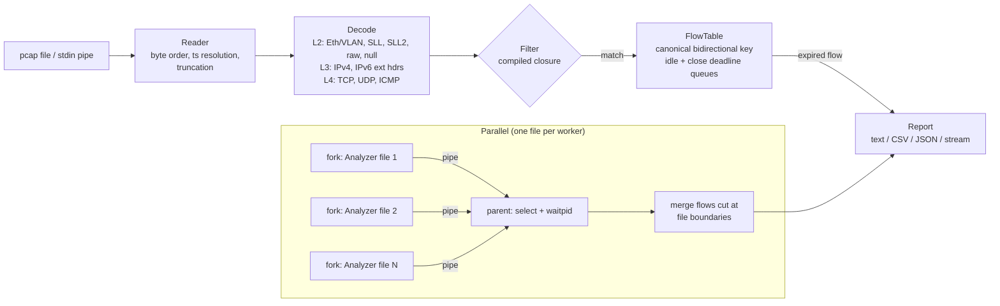

# pcap-flowmeter

A packet-capture flow meter written in Perl. It reads `tcpdump -w` capture
files (or a pipe from `tcpdump -w -`), decodes each frame down to TCP/UDP/ICMP,
and groups packets into bidirectional flows, the way a NetFlow/IPFIX exporter
does. For each flow it reports packets and bytes in each direction, start and
end time, TCP flags, the TCP handshake round-trip time, the VLAN, and why the
flow ended.

It uses only core Perl modules, so it runs on any Linux/Unix box with
perl 5.24 or newer and nothing to install.

What it does:

- **pcap reader/writer**: both byte orders, microsecond and nanosecond
  timestamps, truncated files (a capture killed mid-write), reading from pipes.
- **Decoder**: Ethernet with 802.1Q/QinQ tags, Linux cooked capture
  (`tcpdump -i any`, SLL and SLL2), raw IP, BSD loopback; IPv4 (with optional
  header-checksum check, fragments) and IPv6 (walks hop-by-hop, routing,
  destination-options, fragment and AH extension headers).
- **Filter compiler**: a subset of the tcpdump/BPF filter language
  (`tcp and dst port 443`, `src net 10.0.0.0/8`, `not (tcp or udp)`, ...) is
  parsed by recursive descent and compiled once into a Perl closure. A test
  runs the real `tcpdump` binary on the same file and checks that both select
  exactly the same packets for 26 expressions.
- **Flow table**: bidirectional 5-tuple keys, NetFlow-style idle timeout, TCP
  FIN/RST close handling, port-reuse detection, handshake RTT.
- **Parallel mode**: rotated captures (`tcpdump -C`/`-G`) are processed by
  forked workers that stream results over pipes; the parent multiplexes them
  with `select`, reaps with `waitpid`, and stitches flows that were cut at a
  file boundary.
- **Traffic generator**: writes realistic synthetic captures with known
  ground truth, used by the tests and the benchmark to measure accuracy.

## Quick start

```sh
git clone https://github.com/ShryukGrandhi/pcap-flowmeter
cd pcap-flowmeter
make test                        # 279 tests, plus 27 tcpdump cross-checks if tcpdump is installed

# make a capture and summarise it
perl bin/pcapgen --flows 2000 -o /tmp/demo.pcap
perl bin/pcapflow -t /tmp/demo.pcap

# on a real machine
sudo tcpdump -i any -w /tmp/live.pcap -c 10000
perl bin/pcapflow -f 'tcp and port 443' /tmp/live.pcap
sudo tcpdump -i eth0 -w - | perl bin/pcapflow --stream -     # flows printed as they end

# rotated captures, 4 worker processes
perl bin/pcapflow -j 4 -F csv capture.pcap0 capture.pcap1 capture.pcap2 > flows.csv
```

### `pcapflow` options

```
  -f, --filter EXPR       tcpdump-style filter, e.g. 'tcp and dst port 443'
  -F, --format FMT        text (default), csv or json
  -n, --top N             flows/talkers to show in text output (default 10)
  -t, --talkers           also list top talkers by bytes
  -j, --jobs N            process files in N parallel worker processes
  -s, --stream            print each flow as CSV the moment it expires
  -c, --verify-checksums  verify IPv4 header checksums
      --idle-timeout S    end a flow after S idle seconds (default 60)
      --close-timeout S   linger after TCP FIN/RST (default 5)
```

Exit status: 0 on success, 1 on a runtime error (bad file, bad filter),
2 on a usage error.

Supported filter primitives: `ip ip6 tcp udp icmp icmp6 frag`, `proto N`,
`vlan [N]`, `greater N`, `less N`, `[src|dst] host ADDR`,
`[src|dst] net ADDR/LEN`, `[src|dst] port N`, `[src|dst] portrange N-M`,
combined with `and`/`&&`, `or`/`||`, `not`/`!` and parentheses.

Example output (`perl bin/pcapflow -n 3 /tmp/demo.pcap`, generated with
`pcapgen --flows 2000`):

```
packets 21548  bytes 7119508  ipv4 17590  ipv6 3958  non-ip 0  decode-errors 0
matched 21548  filtered-out 0  fragments 0  bad-ip-checksum 0  files 1
flows 2000  (eof 2000)
  tcp        1199 flows      18102 pkts      6216371 bytes
  udp         613 flows       2462 pkts       473297 bytes
  icmp        151 flows        790 pkts        66360 bytes
  icmp6        37 flows        194 pkts        20176 bytes
tcp handshake rtt (ms): n=1199 p50=20.256 p90=31.012 p99=37.579 max=38.858

top 3 flows by bytes
  proto initiator                                 responder                                     pkts      bytes flags    end
  tcp   10.0.7.45:40450                           192.168.0.9:443                                 22      11306 FSPA     eof
  tcp   [fd00::605]:49858                         [fd00:0:0:1::a]:443                             22      11182 FSPA     eof
  tcp   10.0.1.42:48339                           192.168.0.24:80                                 22      11148 FSPA     eof
```

## Architecture



| Module | Role |
|---|---|
| `PcapFlow::Reader` / `Writer` | libpcap file format; reads from any filehandle, so pipes work |
| `PcapFlow::Decode` | frame → flat hash (addresses, protocol, ports, flags, IP length, VLAN) |
| `PcapFlow::Filter` | recursive-descent parser; emits Perl source, compiled once with `eval` |
| `PcapFlow::FlowTable` | flow state, expiry, TCP close and RTT tracking |
| `PcapFlow::Analyzer` | glues the above; carries flow state across consecutive files |
| `PcapFlow::Parallel` | `fork`/`pipe`/`select`/`waitpid` workers, signal forwarding, flow stitching |
| `PcapFlow::Report` | summary, top flows, top talkers, CSV, JSON |
| `PcapFlow::Gen` | deterministic synthetic traffic + ground truth |

Design notes:

- **Bidirectional key.** The two endpoints (address + port) are sorted
  bytewise and concatenated with the protocol, so both directions hit one hash
  entry. The initiator is the sender of the first packet, unless that packet
  is a SYN/ACK (capture started mid-handshake), in which case it is flipped.
- **Expiry without scanning.** Each flow is put on a deadline queue once,
  when it is created. When its entry reaches the head of the queue and the
  deadline has passed, the flow's real deadline (`last_seen + timeout`) is
  checked: if the flow was active since, it is re-queued, otherwise exported.
  Per-packet updates are O(1) and there is no periodic scan of the table.
  Closed TCP flows go on a second queue with the shorter close timeout. A
  packet for a flow that is past its deadline but not yet reaped is caught at
  lookup time, so flow boundaries are exact regardless of when the queues
  run.
- **Handshake RTT** is measured from the initiator's SYN to its ACK of the
  SYN/ACK. That interval is one full round trip wherever the capture point is
  on the path.
- **Filter safety.** User input is never pasted into the generated code.
  Addresses and masks go into a constant array referenced by index; numbers
  are validated as digits and range-checked before use.
- **Parallel workers** exit with `POSIX::_exit` so they do not run the
  parent's `END` blocks or destructors. The parent reads every pipe through
  `select`, so a worker with lots of output never blocks on a full pipe while
  the parent is waiting on another one. A failing worker fails the whole run
  and the error names the file.

## Tests

`make test` runs `prove -l -r t`:

| File | What it checks |
|---|---|
| `01-reader-writer.t` | round trip in all four magic variants, snaplen, truncated file, pcapng/garbage/corrupt-length rejection, reading through a pipe |
| `02-decode.t` | hand-built frames: checksum (RFC 1071 example), VLAN/QinQ, IPv6 extension headers, v4/v6 fragments, ICMP echo pairing, SLL/SLL2/raw/null, ARP, malformed and snaplen-cut frames |
| `03-filter.t` | 33 expressions against 6 packets, precedence, 14 malformed expressions |
| `04-flowtable.t` | full TCP session, SYN/ACK-first orientation, idle split at the exact boundary, lazy re-queueing, RST + port reuse, half-close, close linger |
| `05-accuracy.t` | generated captures for 4 link types: every flow's counters, times and VLAN equal the ground truth |
| `06-parallel.t` | one file vs. the same capture split into 5 files, serial and `-j 3`, with default and very short idle timeouts and a filter; failing workers; no zombies |
| `07-cli.t` | output formats, stdin and shell pipelines (`pcapgen -o - \| pcapflow -`), `--stream \| head`, `-j`, exit codes |
| `08-tcpdump.t` | runs the system `tcpdump`: it reads every packet we write, and 26 filter expressions select the same packet counts as libpcap |

CI (GitHub Actions) runs the suite on Ubuntu with tcpdump installed, on
macOS, and in the official `perl:5.24`, `perl:5.30` and `perl:5.40` Docker
images, and runs the quick benchmark in each job.

## Benchmark

`bench/bench.pl` generates a capture with the built-in generator, times each
pipeline stage (best of 3 runs), times serial vs. forked processing of the
same capture split into 4 consecutive files, and scores the flows against the
generator's ground truth. It exits non-zero if any flow is wrong.

Command: `perl bench/bench.pl` (or `make bench`). Output from one run on an
Apple Silicon Mac (Darwin arm64, perl 5.34.1):

```
input: 20000 flows, 214020 packets, 74.2 MB pcap (generated in 0.92 s); best of 3 runs

| stage                                  |  seconds |    packets/s |     MB/s |
|----------------------------------------|----------|--------------|----------|
| read records (Reader)                  |    0.132 |      1619916 |    561.8 |
| read + decode L2-L4                    |    0.674 |       317393 |    110.1 |
| full pipeline (flows)                  |    1.217 |       175898 |     61.0 |
| full + filter 'tcp and dst port 443'   |    0.942 |       227179 |     78.8 |
| full + IPv4 checksum verify            |    1.350 |       158508 |     55.0 |

parallel, 4 consecutive files:
| mode                                   |  seconds |    packets/s | speed-up |
|----------------------------------------|----------|--------------|----------|
| serial (one process)                   |    1.316 |       162689 |    1.00x |
| fork, -j 2                             |    0.993 |       215606 |    1.33x |
| fork, -j 4                             |    0.652 |       328228 |    2.02x |

accuracy vs generator ground truth: 20000/20000 flows found, 20000/20000 exact (packets, bytes, first/last time) = 100.00%
flows reported: 20000 (single file), 20000 (parallel, after merging file-boundary splits); 20000/20000 identical
```

Reading the numbers:

- The full pipeline runs at about 176k packets/s in one process. Decoding
  and the flow table each take about 45% of the time (0.54 s each); reading
  the records is cheap (0.13 s, 1.6M records/s).
- The filtered run is faster than the unfiltered one because packets that
  do not match skip the flow table.
- Four workers give about 2x, not 4x. The parent still parses every flow
  record coming back over the pipes and merges flows that cross file
  boundaries, and that part is serial.
- The accuracy line is against synthetic traffic, which the decoder
  understands fully. It shows the flow logic is exact; it does not say
  anything about traffic types the generator does not produce.

Timings will differ on other machines; `make bench-quick` (2000 flows) runs in
about a second and is what CI runs.

## Limitations

- Classic pcap only. pcapng files are rejected with a message suggesting
  `editcap -F pcap`.
- Timestamps are kept as Perl floating-point seconds, which is about
  0.25 µs resolution for current epoch times. Nanosecond captures are read
  but not reported at full precision.
- IP fragments are not reassembled. Non-first fragments have no ports and
  are counted in a separate flow with ports 0.
- Bytes are IP-layer bytes (IP total length), like NetFlow, not frame bytes.
- The filter language is a subset of tcpdump's: no byte-offset expressions
  (`tcp[13] & 2 != 0`), no `ether`/MAC primitives, no shorthand such as
  `port 80 or 443`. `vlan` only tests the outer tag, and unlike BPF, other
  primitives also match inside VLAN-tagged frames.
- In parallel mode, flows that cross a file boundary are stitched using the
  timeouts. If a TCP close (the two FINs) is itself split across files and
  packets keep arriving after the close timeout, the parallel result can
  differ from the serial one. Serial mode (`-j 1`, the default) has no such
  case. Peak active flows in parallel mode is a per-file maximum.
- Pure Perl: roughly 150-180k packets/s per core on the machine above. That
  is fine for offline analysis of captures, not for line-rate monitoring of a
  busy link.
- No live capture. It reads files or `tcpdump -w -` output; it does not open
  network interfaces itself.
